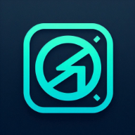

<div align="center">



# Ghaizers 2.0

**Minecraft Resource Pack Optimizer — 100% di browser, gratis, tanpa upload.**

Kecilkan ukuran pack, ringankan untuk HP & Pojav, tanpa mengorbankan tampilan.

[](https://optimizer.ghaa.my.id)
[](#-changelog)
[](LICENSE)


[**Coba Sekarang**](https://optimizer.ghaa.my.id) · [Fitur](#-fitur-utama) · [Cara Kerja](#-cara-kerja) · [Instalasi](#-instalasi) · [FAQ](#-faq)

</div>

---

## ✨ Kenapa Ghaizers?

| | |
|---|---|
| 🔒 **Privat** | Semua proses berjalan di browser kamu. Pack tidak pernah dikirim ke server mana pun. |
| 🧠 **Smart PNG Encoder** | Encoder PNG lossless buatan sendiri (palette + adaptive filter), bukan encoder canvas browser yang sering membuat file membesar. |
| 🛡️ **Size Guard** | Setiap file dibandingkan dengan aslinya. Yang lebih kecil yang dipakai, jadi pack tidak akan membesar. |
| ⚡ **Cepat** | Pemrosesan paralel dengan Web Worker pool, browser tidak freeze. |
| 📱 **Ramah HP** | UI responsif, preset khusus Pojav Launcher & device low-end. |
| 🆓 **Gratis selamanya** | Open source, tanpa akun, tanpa iklan. |

---

## 🚀 Fitur Utama

### 🖼️ PNG
- **Smart PNG Encoder** — palette/indexed (1/2/4/8-bit), color type minimum, adaptive row filter. 100% lossless.
- **Smart Resize** — scale per kategori folder (GUI, font, entity, particle). Texture **tidak pernah di-upscale**.
- **Alpha Cleanup** — nol-kan RGB pada pixel transparan penuh (tanpa perubahan visual).
- **Single-Color Detection** — texture satu warna dipadatkan menjadi 1×1.
- **Power-of-Two** — snap ke 16/32/64/… untuk efisiensi GPU.
- **Metadata Strip** — buang chunk tersembunyi (`tEXt`, `iCCP`, `gAMA`, dll).
- **Palette Quantize** *(opsional, lossy)* — texture besar dikurangi jadi maks 256 warna.
- **Aman by design** — APNG, PNG interlaced, dan 16-bit tidak disentuh.

### 📄 File lain
- **JSON** — minify, deep clean (hapus field komentar), key sorting untuk kompresi lebih baik.
- **OGG** — strip ID3 & padding, **tanpa re-encode** (kualitas identik).
- **Shader / `.properties` / `.lang` / `.bbmodel`** — minify & cleanup.
- **File sampah** — `.DS_Store`, `Thumbs.db`, `__MACOSX`, dll otomatis dibuang.

### 🧰 Tools
- **Pack Analyzer** — scan masalah (oversized, JSON rusak, duplikat, file kosong) tanpa optimize.
- **pack.mcmeta Editor** — edit langsung, credit otomatis diinjeksi.
- **Pojav Log Auto-Fix** — parse `latestlog.txt` dan perbaiki texture animasi bermasalah.
- **Custom pack icon**, **SHA-1 checksum**, **Badge generator**, **Share hasil**.
- **Dwibahasa** — Indonesia & English.

---

## 🎚️ Mode & Preset

| Mode | Scale | Maks. ukuran | Cocok untuk |
|---|:---:|:---:|---|
| **Lossless** | 100% | Tanpa resize | Pack yang tampilannya tidak boleh berubah |
| **Normal** | 85% | 512 px | Seimbang kualitas & ukuran |
| **Extreme** | 55% | 128 px | Device mid–low |
| **Ultra Extreme** | 35% | 64 px | HP kentang / Pojav lemah |

**Preset siap pakai:** `Lossless Safe` · `Pojav Lite` · `Server Pack` · `Ultra Compress` · `Quality`

> 💡 Mulai dari **Lossless Safe** untuk hasil aman, lalu naik ke mode lebih agresif bila perlu.

---

## 🔬 Cara Kerja

```
 ZIP pack ──► scan entri ──► proses paralel (Web Worker pool)
                               │
                               ├─ PNG  : strip meta → resize → alpha clean → (quantize)
                               │         → encode lossless → ⚖️ Size Guard (pilih terkecil)
                               ├─ JSON : clean → sort → minify
                               ├─ OGG  : strip ID3 (tanpa re-encode)
                               └─ lainnya: copy / minify
                               │
                               ▼
                    susun ZIP ──► SHA-1 ──► download
```

**Kenapa PNG bisa membesar di optimizer lain?** Encoder PNG bawaan browser (canvas) selalu menulis RGBA tanpa palette dan tanpa filter optimal, sehingga hasilnya sering lebih besar dari PNG asli. Ghaizers menulis PNG sendiri (`src/lib/png.js`) lalu membandingkan hasilnya dengan file asli sebelum dipakai.

---

## 📦 Instalasi

**Prasyarat:** Node.js 18+ (disarankan LTS)

```bash
git clone https://github.com/PickoCore/Ghaizers2.0.git
cd Ghaizers2.0
npm install
npm run dev        # http://localhost:4321
```

| Perintah | Fungsi |
|---|---|
| `npm run dev` | Dev server |
| `npm run build` | Build produksi ke `dist/` |
| `npm run preview` | Preview hasil build |
| `npm run test:png` | Tes engine PNG (round-trip lossless) |

### 📱 Lewat Termux

```bash
pkg update -y && pkg install git nodejs-lts -y
git clone https://github.com/PickoCore/Ghaizers2.0.git
cd Ghaizers2.0 && npm install && npm run dev
```

### ☁️ Deploy

Project ini statis (SSG) dan siap di Vercel, Cloudflare Pages, atau Netlify.
Build command: `npm run build` · Output directory: `dist`

---

## 🗂️ Struktur Project

```
Ghaizers2.0/
├── astro.config.mjs
├── package.json
├── public/                    # favicon, manifest, robots.txt, sitemap
├── scripts/
│   └── test-png.mjs           # tes engine PNG
└── src/
    ├── components/
    │   ├── PackOptimizer.jsx  # UI + pipeline utama (React island)
    │   ├── PrivacyContent.jsx
    │   └── TermsContent.jsx
    ├── layouts/Layout.astro   # SEO shell: meta, OG, JSON-LD
    ├── lib/
    │   ├── png.js             # decoder/encoder/quantizer PNG lossless
    │   ├── pngWorker.js       # Web Worker: 1 job = 1 PNG
    │   └── i18n.js            # terjemahan ID/EN
    ├── pages/                 # index, privacy, terms
    └── styles/globals.css
```

---

## 🧪 Pengujian

Engine PNG dites round-trip terhadap pixel asli (decode → encode → decode) untuk palette, grayscale, RGB, RGBA, dan 1-bit.

```bash
npm run test:png
```

---

## ❓ FAQ

<details>
<summary><b>Apakah pack saya diunggah ke server?</b></summary>

Tidak. Semua proses terjadi di browser (client-side).
</details>

<details>
<summary><b>Apakah kualitas texture berkurang?</b></summary>

Tergantung mode. **Lossless** tidak mengubah pixel sama sekali. Mode Normal/Extreme/Ultra menurunkan resolusi sesuai skalanya. Alpha Cleanup, Metadata Strip, dan encoder PNG bersifat lossless secara visual.
</details>

<details>
<summary><b>Ukuran hasil tidak lebih kecil, kenapa?</b></summary>

Pack kemungkinan sudah sangat optimal. Size Guard menjaga agar file tidak membesar. Coba preset **Ultra Compress** atau aktifkan **Palette Quantize** bila boleh ada sedikit perubahan warna.
</details>

<details>
<summary><b>Apakah OGG di-re-encode?</b></summary>

Tidak. Hanya metadata ID3 dan padding yang dibuang, kualitas audio identik.
</details>

<details>
<summary><b>Browser apa yang disarankan?</b></summary>

Chrome atau browser berbasis Chromium (Edge, Brave, dll). Dibutuhkan Web Worker, OffscreenCanvas, dan Compression Streams.
</details>

---

## 📝 Changelog

### v2.2
- 🐞 **Fix:** ukuran pack naik setelah optimize (encoder canvas + tanpa size guard)
- 🐞 **Fix:** texture kecil tidak lagi di-upscale; atlas non-strip tidak lagi digepengkan
- 🐞 **Fix:** file tidak lagi hilang saat worker gagal; worker kini paralel sungguhan
- ✨ Smart PNG Encoder, Size Guard universal, mode & preset Lossless Safe
- ✨ Palette Quantize opsional, ringkasan hasil baru (Top penghematan, Download lagi)

### v2.0
- Astro.js + SEO enterprise (SSG, JSON-LD, sitemap)
- Pack Analyzer, preset system, power-of-two, JSON key sorting, `.lang` & `.bbmodel`

### v1.x
- Alpha cleanup, single-color detection, deep JSON clean, OGG safe strip, Web Workers, Pojav Log Auto-Fix, SHA-1

---

## 🤝 Kontribusi

Issue dan pull request sangat diterima.

1. Fork repo ini
2. Buat branch: `git checkout -b fitur/nama-fitur`
3. Jalankan `npm run test:png` dan `npm run build`
4. Commit & buka Pull Request

---

## ⚖️ Lisensi & Kredit

Kode dirilis di bawah lisensi [MIT](LICENSE).

**Ghaizers 2.0** dibuat oleh **ghaa ([KhaizenNomazen](https://github.com/KhaizenNomazen))**.
Tool ini **gratis**. Jika ada yang menjualnya kepadamu, kamu sedang ditipu — laporkan lewat GitHub.

<div align="center">

⭐ Kalau tool ini membantu, kasih bintang di repo ya!

[**optimizer.ghaa.my.id**](https://optimizer.ghaa.my.id)

</div>
